# Luscii API Research — Care Pathways

Research notes on the Luscii integration surface, focused on **care pathways** and what an integrator can do via API. Includes MDR/regulatory context.

---

## 1. TL;DR

- A **care pathway = a Program** in Luscii. Programs are authored only by Luscii-certified Medical Developers (clinicians + Luscii training). They are **not** something a third party can create or mutate via API.
- The Public API exposes care pathways as **read-only catalog data** (`programs`, `protocols`, `program-actions`, `program-moments`, plus localizations) and lets you **enroll patients into a pathway** at patient creation by passing `programId` + `protocolId`.
- The **dynamic side** of a pathway (alerts, measurements, lifecycle) is consumed via **FHIR webhooks** (Patient / Observation / Flag) and the **Public API webhooks** (Patient Created / Status Updated / Messages).
- **MDR**: `Luscii vitals` (the "Clinical Engine") is **CE-marked Class IIa** under MDD 93/42/EEC and re-certified under **MDR EU 2017/745** by KIWA. ISO 13485, ISO 27001, NEN 7510/7512. Class IIa rationale: it autonomously monitors vital physiological functions and generates clinician-facing alerts. Anything you build on top inherits regulatory implications — see §6.
- The pathway logic itself (thresholds, schedules, alert rules) lives **inside the Luscii medical device**. You consume its outputs; you do not re-implement them.

---

## 2. Sources

Primary docs (all under `integrations.luscii.com/docs/*`):

- Concepts: <https://integrations.luscii.com/docs/important-luscii-concepts>
- Getting started: <https://integrations.luscii.com/docs/getting-started>
- Public API intro: <https://integrations.luscii.com/docs/public-api>
- Authentication: <https://integrations.luscii.com/docs/authentication-and-authorization>
- Patient API: <https://integrations.luscii.com/docs/patient>
- Programs: <https://integrations.luscii.com/docs/programs>
- Protocols: <https://integrations.luscii.com/docs/protocols>
- Program actions: <https://integrations.luscii.com/docs/program-actions>
- Program moments: <https://integrations.luscii.com/docs/program-moments>
- Export API: <https://integrations.luscii.com/docs/export-api>
- FHIR webhooks intro: <https://integrations.luscii.com/docs/fhir-webhooks-introduction>
- Receiving patient events: <https://integrations.luscii.com/docs/receiving-patient-details>
- Receiving observations: <https://integrations.luscii.com/docs/receiving-observations-measurements>
- Public API webhooks: <https://integrations.luscii.com/docs/public-api-webhooks>
- Viewer SSO: <https://integrations.luscii.com/docs/viewer-introduction>
- Opening the viewer: <https://integrations.luscii.com/docs/opening-the-viewer>
- Patient API key: <https://integrations.luscii.com/docs/obtaining-an-patient-api-key>

Technical reference (machine-readable / try-it-now): <https://vitalsapi.luscii.com/public-api/documentation>
*This is the same vendor — `vitalsapi.luscii.com` is the official Luscii hosted reference linked from `integrations.luscii.com`.*

Regulatory:

- IFU: <https://luscii.com/en/ifu>
- Compliance overview: <https://luscii.com/en/compliance-start-page>
- CE certification (UK page): <https://luscii.co.uk/ce-certification>

---

## 3. Mental Model

| Luscii term       | What it really is                                                                  |
| ----------------- | ---------------------------------------------------------------------------------- |
| Program           | The care pathway — a frozen, certified configuration (instruments, schedules, thresholds, alert logic, education, milestones, care network). |
| Protocol          | A variant **bound to one Program** (`programId`) tweaking timing/reminders/overdue/inactivity behaviour. Patient is enrolled with `programId` **and** `protocolId`. |
| Program moment    | A scheduled checkpoint inside a program (`type`, `name`, `patientAccess`).         |
| Program action    | A configurable step within a program (e.g. category `selfcare`, `onlyWhenPlanned`). |
| Localization      | Translated copy attached to programs / actions / moments.                          |
| Instrument        | A measurement type (BP, weight, questionnaire item) — emitted as FHIR Observation, may carry SNOMED CT codes. |
| Patient (account) | One account = exactly one Program. Comorbidities = multiple accounts on the same human. |
| Flag              | An alert (FHIR Flag), priority-tagged, lifecycle: created → escalated → processed. |
| Observation       | A measurement / calculation / note / inactivity event (FHIR Observation).          |

> Important: there is **no `episode` resource**. The Program + Protocol pair *is* the enrollment context for a patient account.

---

## 4. What you can do with the API around care pathways

### 4.1 Read the pathway catalog (Public API)

Base: `https://api.luscii.com/v1/`
Auth: `Authorization: Bearer <api-key>` (org-level key inherits org admin scope).

| Method & path                       | Use                                                              |
| ----------------------------------- | ---------------------------------------------------------------- |
| `GET /v1/programs`                  | List care pathways available in your org. Returns `id`, `name`, `informationUrl`, `isTwoWayMessagingEnabled`, `createdAt`. |
| `GET /v1/protocols`                 | List protocols. Each has `programId`, reminder timings (patient/healthcare/overdue), timezone, inactivity limits, comment-alert triggers. |
| `GET /v1/program-actions`           | Actions defined inside programs (`category`, `onlyWhenPlanned`, `programId`). |
| `GET /v1/program-moments`           | Scheduled moments (`type`, `name`, `patientAccess`, `programId`). |
| `GET /v1/program-actions/{id}/items`, `.../localizations` | Sub-resources on actions. |
| `GET /v1/program-moments/{id}/localizations`              | Translations on moments. |

Use this to populate a pathway picker in your own UI before enrolling.

### 4.2 Enroll a patient into a pathway

`POST /v1/patients` — required: `accountName`, `email`, `firstName`, `lastName`, `sex`, `organizationId`, `groupId`, `programId`, `protocolId`. Optional: DOB, address, phone (e.164 → enables SMS login), `language` (`nl|en|en_US|de|fr`), `timezone`, FHIR identifier array (BSN, NHS, Chipsoft Workflow ID, Zorg Bij Jou ID, etc.). Returns 201.

`GET /v1/patients` (paginated, cursor + `perPage` 1–200) and `GET /v1/patients/{patientId}` for read-back. The patient resource exposes the active `program` and `protocol` references.

To **switch pathway**: create another patient account on the same person (Luscii's documented mechanism for multi-pathway / comorbidity).

### 4.3 Receive what happens inside the pathway (FHIR webhooks)

Transport: HTTP POST, `Content-Type: application/fhir+xml`, signed with `X-Webhook-Signature` (HMAC-SHA256 of raw body using shared secret). Optional `Authorization` header configurable. Delivery SLA: connect <2s, response <10s, 2xx required. Retry: exponential backoff 1/2/4/8/16 min, max 6 attempts. **At-least-once → dedupe required.**

Events:

| Resource    | Events                                                              |
| ----------- | ------------------------------------------------------------------- |
| Patient     | `PatientActivated`, `PatientUpdated`, `PatientDeactivated`. Includes Luscii UUID (`urn:oid:2.16.840.1.113883.2.4.3.135`), BSN, NHS Number, optional email. `active=true/false` reflects on/offboarding. The meta `code` carries the event name. |
| Observation | `ObservationCreated`. Subtypes: measurement, calculation (e.g. BMI), note, inactivity. SNOMED CT preferred (`http://snomed.info/sct`); fallback Luscii instrument/item ID. Subject = Luscii patient UUID. |
| Flag        | `AlertCreated`, `AlertEscalated`, `AlertProcessed`. Priority-tagged. |

The pathway is **not explicitly named in the FHIR payload** — link it on your side via the Luscii patient UUID → patient record (which carries `programId` / `protocolId`).

### 4.4 Public API webhooks (non-FHIR, JSON)

`POST` to your URL when: **Patient Created**, **Patient Status Updated**, **Messages**. Inspect / requeue via:

- `GET /v1/webhooks-events` (filter status / dates / pagination)
- `GET /v1/webhooks-events/{id}` (full request history)
- `PATCH /v1/webhooks-events/` → set `pending` to retry

Event states: `pending`, `success`, `failing`, `failed`.

### 4.5 Bulk export (NOT for clinical use)

`POST /v1/export/{reportType}` with `startDate` / `endDate`. 13 report types incl. patients, measurements, alerts, healthcare providers, star ratings, planned actions, **historical workflow / programs / settings / user status changes**. Cursor pagination. JSON.

Doc explicitly states: "**not intended or designed for use in a clinical setting where data is used to provide care to patients**." Treat as BI/audit only.

### 4.6 Embedded clinician UI (Viewer)

`POST /login/external/saml` (region-specific cluster: EU / EU-Acceptance / UK) with base64 SAML Response (signed assertions) + FHIR `system + value` patient identifier. The viewer auto-selects that one patient, lets clinicians view/process alerts, view full measurement history, view/edit patient details. Only one patient at a time — no cross-patient navigation. SAML can prefill onboarding fields. Sensitive payloads (e.g. patient API keys for SDK) **should** use `EncryptedAssertion`. Service accounts available for shared read-only roles.

Care pathway is **not deep-linkable** beyond the patient's enrolled program — IFU notes "Some Luscii specific elements (e.g. Luscii care pathway, device ordering) might need to be manually configured."

### 4.7 What you **cannot** do via API

- Create / edit / version a program (care pathway). Authoring stays inside Luscii's certified Medical Developer workflow.
- Mutate alert thresholds or schedules per patient via API (handled by program + protocol selection).
- Trigger a program action ad-hoc — `program-actions` is a read endpoint; execution is driven by program logic + `onlyWhenPlanned`.
- Move a patient between programs in place — model is "new account per program".
- Pull pathway state from FHIR payloads — you must join via patient UUID.

---

## 5. Auth & ops cheatsheet

- Public API: Bearer token. Org admin key vs patient key — keys inherit the user's authorization. Patient keys created via UI ("API Keys" on the patient profile, shown once) or programmatically once an admin key exists. For MDM use, set lifetime "Never".
- Webhook auth: HMAC-SHA256 over raw body, header `X-Webhook-Signature`, compare with `hash_equals`-style constant-time. Optional `Authorization` header on top.
- Pagination: cursor (`cursor` + `perPage` 1–200, default 50). Response meta carries `prevCursor` / `nextCursor`.
- Response envelope: `{ data, meta, errors[{code,message,attribute?}] }`.
- Identifier systems Luscii recognises: `urn:oid:2.16.840.1.113883.2.4.3.135` (Luscii UUID), `http://fhir.nl/fhir/NamingSystem/bsn`, `https://fhir.nhs.uk/Id/nhs-number`, Chipsoft Zorgplatform Workflow ID, Zorg Bij Jou ID.

---

## 6. MDR / regulatory implications for an integrator

- `Luscii vitals` is a **Class IIa medical device** (MDD 93/42/EEC + MDR EU 2017/745, audited annually by KIWA). Rationale: monitors vital physiological functions and produces clinician-facing alerts. `Luscii contact` (messaging) is **not** a medical device.
- Programs (care pathways) are part of the certified device. Their thresholds, alert logic, and schedules are clinically validated artefacts — **do not duplicate or override them** in your wrapper.
- Risk of accidentally becoming a manufacturer (Article 23 MDR / "significant modification"):
  - Re-deriving alerts from raw observations on your side → likely makes your layer a medical device function.
  - Suppressing / delaying / re-prioritising Luscii Flags before clinician sees them → significant modification of intended use.
  - Re-rendering Luscii data in a clinician-facing UI that replaces the Viewer → your UI now part of the clinical workflow; needs its own QMS / risk file.
- Safer integration patterns:
  - Use **Viewer SSO** for clinician-facing pathway interaction. Stays inside the certified device boundary.
  - Use **FHIR webhooks** to mirror data into your store **for non-clinical purposes** (audit, BI, EHR archive). Same caveat as the Export API.
  - Use **Public API patient creation** to push enrollments from your scheduling / EHR side, but let Luscii own pathway selection logic by exposing `programs` / `protocols` from `GET` endpoints rather than hardcoding IDs.
- Operational hooks tied to MDR:
  - Honour at-least-once webhook semantics → idempotent ingestion is a safety property, not a nice-to-have.
  - Never silently drop a Flag — at minimum log + ack. The Class IIa rationale is "prioritised lists requiring clinician attention"; loss of a Flag is a safety event.
  - Keep the Export API **out of clinical paths** — Luscii's IFU explicitly excludes that use.
  - IFU version control: current Clinician IFU referenced is v1.8 (2022-03-10) — re-check before go-live.

---

## 7. Practical integration shapes (for the wrapper)

1. **EHR → Luscii enroll**: pull `GET /v1/programs` + `GET /v1/protocols` once a day, cache, expose as picker. On enroll → `POST /v1/patients` with chosen `programId` + `protocolId` + FHIR identifier (BSN/NHS/etc.).
2. **Luscii → EHR sync**: subscribe to FHIR webhooks; map Luscii patient UUID ↔ EHR patient on `PatientActivated`; persist Observations + Flags; surface Flags as tasks. Dedupe on FHIR resource id + meta event code.
3. **Clinician handoff**: instead of re-implementing the Luscii dashboard, embed `Viewer` via SAML POST with the EHR's patient identifier; lets clinicians act on alerts inside the certified UI.
4. **Reporting**: nightly `POST /v1/export/{reportType}` for BI; never wired into clinical decision flows.

---

## 8. Care pathway BUILDER side — what API gives you

**Short answer: read-only. No CRUD on the builder side.**

The authoring tool is **Luscii Builder®** — a drag-and-drop GUI inside the Luscii web app, accessible only to **Certified Medical Developers** (CMDs). CMDs are clinicians (doctors / nurses) who passed Luscii's 6-module Certified Medical Developer Program and hold a Builder license. Sources: <https://luscii.com/en/cmdp>, <https://support.luscii.com/en/cmd/what-is-the-cmd-program>.

### What Luscii Builder lets a CMD configure (none of this is API-writable)

- Measurement schemes (which instruments, when, how often)
- Alert thresholds + alert logic
- Self-care content / patient education
- Patient timeline / journey moments
- Notification + escalation rules
- Care network settings
- Localizations

### What the Public API actually allows on programs / protocols / actions / moments

| Resource                     | GET (list/read) | POST (create) | PUT/PATCH (update) | DELETE |
| ---------------------------- | --------------- | ------------- | ------------------ | ------ |
| `/v1/programs`               | ✅              | ❌            | ❌                 | ❌     |
| `/v1/protocols`              | ✅              | ❌            | ❌                 | ❌     |
| `/v1/program-actions`        | ✅              | ❌            | ❌                 | ❌     |
| `/v1/program-actions/{id}/items` | ✅ (sub-list) | ❌          | ❌                 | ❌     |
| `/v1/program-actions/{id}/localizations` | ✅    | ❌            | ❌                 | ❌     |
| `/v1/program-moments`        | ✅              | ❌            | ❌                 | ❌     |
| `/v1/program-moments/{id}/localizations` | ✅    | ❌            | ❌                 | ❌     |

Verified against `integrations.luscii.com/docs/program-actions`, `.../program-moments`, `.../programs`, `.../protocols`. Each page documents **only `GET`**. The interactive reference at `vitalsapi.luscii.com/public-api/documentation` is the source of truth — log in with an org admin key and inspect the OpenAPI spec to confirm no hidden write routes exist for your tenant.

### Why it is locked down

Programs are part of the **CE Class IIa medical device**. Letting third-party code mutate alert thresholds or schedules would be a "significant modification" under MDR Article 23 and would invalidate Luscii's certification. Authoring is therefore gated behind:

1. A human CMD (clinical accountability)
2. The Builder GUI (controlled change surface, audit trail)
3. Luscii's own QMS / release process

### What you CAN do on the runtime side of pathways via API

- **Patient lifecycle inside a pathway**: create patient on a pathway (`POST /v1/patients` with `programId` + `protocolId`), read enrollment state (`GET /v1/patients/{id}`), deactivate (handled implicitly via patient status updates surfaced as `PatientDeactivated` webhook).
- **Observe what the pathway is doing**: subscribe to FHIR webhooks for Observations + Flags + Patient events (§4.3) and Public API webhooks for Patient Created / Status Updated / Messages (§4.4).
- **Mirror catalog**: cron `GET /v1/programs` + `/v1/protocols` + `/v1/program-actions` + `/v1/program-moments` to keep an internal copy of pathway metadata for picker UIs / reporting.

### Workarounds if you need pathway change capability

- New pathway / variant → ask a CMD in your org to author it in Builder. Then it becomes visible on `GET /v1/programs`.
- "Per-patient tweak" → not possible at the program level; the closest knobs are choosing a different `protocolId` (which already varies reminder timings, overdue/inactivity behaviour) or moving the patient to a different program (= new patient account).
- Bulk updates across patients → cannot be scripted via API on the program side; must be done in Builder by a CMD.

### Decision rule for the wrapper

If your use case requires **programmatic create/update/delete of pathways**, the Public API will not satisfy it. Options:

1. Treat Luscii Builder as the system of record for pathway authoring; integrate only on enrollment + runtime data.
2. Negotiate with Luscii for a private / partner API (none documented publicly).
3. Build pathway logic on your own side and **only use Luscii as a measurement+alert engine** — but doing so likely puts pathway logic outside the certified device, which has the MDR implications in §6.

---

## 9. Orchestrator pattern — diagrams

We (the orchestrator app) own the patient journey. Luscii owns the certified pathway runtime. Diagrams below show the split.

### 9.1 Component view

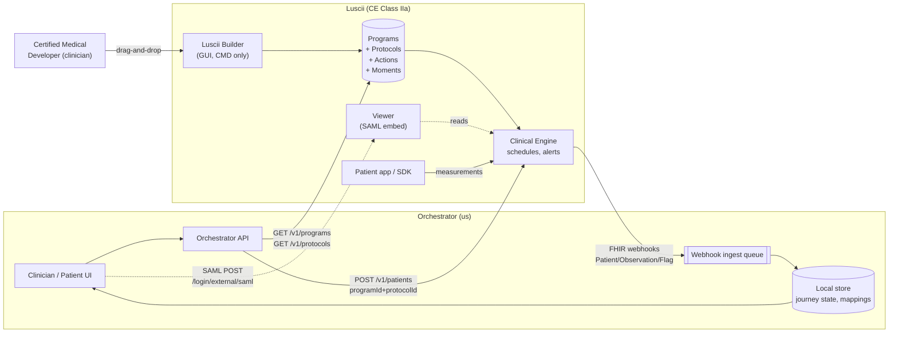

### 9.2 Build phase — pathway authoring (one-time / when catalog changes)

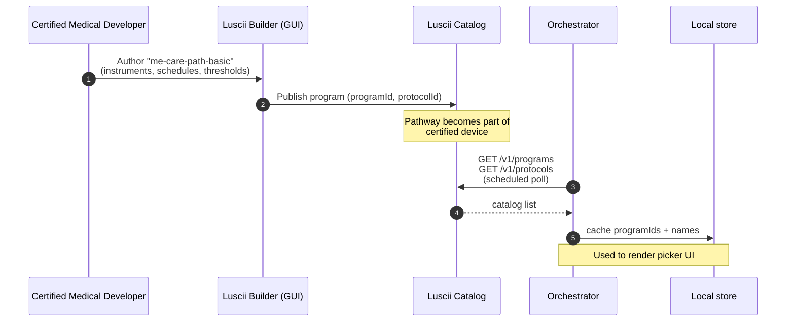

### 9.3 Enrollment — patient onto pathway

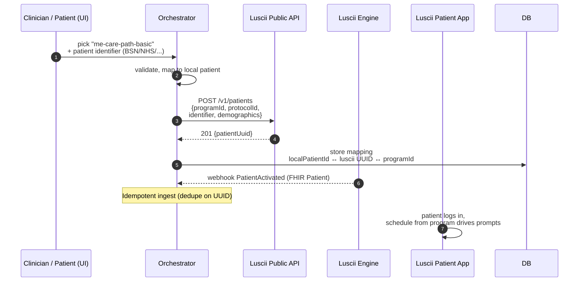

### 9.4 Runtime — measurements + alerts flow back

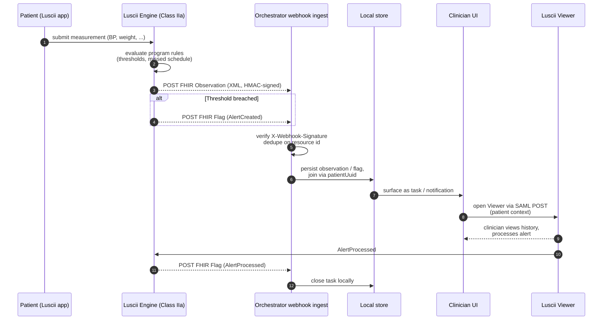

### 9.5 "Me-care-path" — composite journey across multiple Luscii programs

If a single Luscii program does not cover everything you want in one journey, stack them. Same human → multiple Luscii patient accounts → orchestrator presents one unified view.

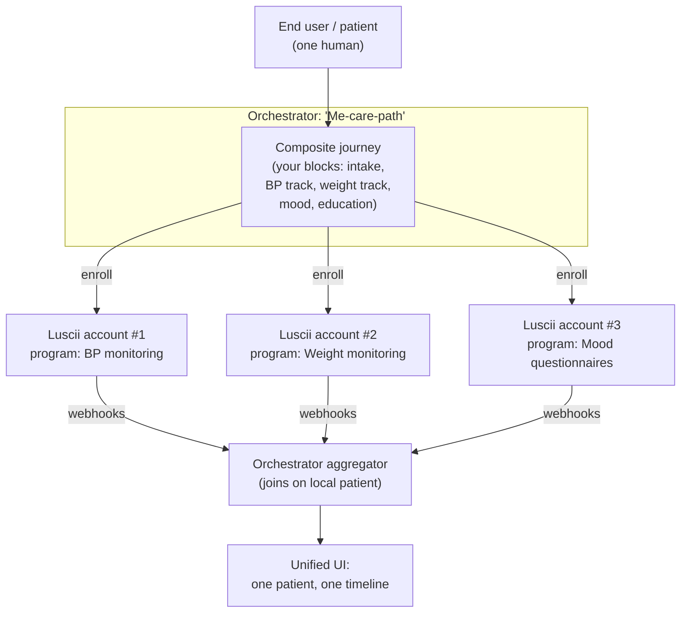

### 9.6 Boundary rules to keep MDR-clean

- Orchestrator may **route, store, display, schedule its own non-clinical reminders**.
- Orchestrator **must not** suppress, delay, re-prioritise, or re-derive Luscii Flags before clinician sees them.
- Orchestrator **must not** invent thresholds on raw Observations (that turns it into a Class IIa device).
- For clinician interaction with alerts/history, prefer the **Luscii Viewer** embed over a custom UI.
- Webhooks: at-least-once → idempotent ingest is a safety property.

---

## 10. Cross-check — what is verified, what is inferred, what is unknown

Methodology: re-read every doc page cited and re-grep for the specific claim. Marked ✅ verified, ⚠️ inferred (plausible from docs but not stated), ❌ unknown / requires Luscii confirmation.

### Catalog reads (program builder side)

| Claim | Status | Evidence |
| --- | --- | --- |
| `GET /v1/programs` exists | ✅ | `/docs/programs` documents it with response shape |
| `GET /v1/protocols` exists | ✅ | `/docs/protocols` |
| `GET /v1/program-actions` exists | ✅ | `/docs/program-actions` |
| `GET /v1/program-moments` exists | ✅ | `/docs/program-moments` |
| Sub-resources `…/items`, `…/localizations` exist as GET | ⚠️ | Listed in nav menu, exact paths inferred — verify in `vitalsapi.luscii.com/public-api/documentation` |
| **No POST/PUT/PATCH/DELETE** on programs/protocols/actions/moments | ✅ | Each doc page lists only `GET`. Builder is GUI-only |
| Programs authored only by Certified Medical Developers in Luscii Builder | ✅ | `luscii.com/en/cmdp`, `support.luscii.com/en/cmd/what-is-the-cmd-program` |

### Patient enrollment

| Claim | Status | Evidence |
| --- | --- | --- |
| `POST /v1/patients` with `programId` + `protocolId` enrolls into pathway | ✅ | `/docs/patient` lists both as required |
| `GET /v1/patients`, `GET /v1/patients/{id}` exist | ✅ | `/docs/patient` |
| **No PATCH/PUT on patient** → cannot switch program in place | ✅ | Re-checked `/docs/patient` — only GET + POST documented |
| **No DELETE on patient** → cannot deactivate via documented public API | ✅ | Same. Deactivation appears to be a Luscii web-app action, surfaced to integrators only as the `PatientDeactivated` webhook |
| Multi-pathway = multi-account on same human | ✅ | `/docs/important-luscii-concepts` quote: *"if a patient needs to be enrolled into multiple programs (because of comorbidities for instance) multiple accounts will be created for this patient"* |
| Patient app supports switching between accounts | ✅ | `support.luscii.com` — Accounts switcher in top-left of home screen |
| FHIR identifier array on patient (BSN, NHS, Chipsoft, ZBJ) | ✅ | `/docs/patient`, `/docs/opening-the-viewer`, `/docs/receiving-patient-details` |

### Webhooks

| Claim | Status | Evidence |
| --- | --- | --- |
| FHIR webhooks emit Patient/Observation/Flag | ✅ | `/docs/fhir-webhooks-introduction` |
| Events: `PatientActivated/Updated/Deactivated`, `ObservationCreated`, `AlertCreated/Escalated/Processed` | ✅ | Same doc lists all seven |
| `application/fhir+xml`, `X-Webhook-Signature` HMAC-SHA256 | ✅ | `/docs/fhir-webhooks-introduction` + `/docs/authentication-and-authorization` |
| At-least-once delivery, retries 1/2/4/8/16 min, dedupe required | ✅ | `/docs/fhir-webhooks-introduction` |
| Public API webhooks (JSON) for Patient Created / Status Updated / Messages | ✅ | `/docs/public-api-webhooks` |
| `/v1/webhooks-events` list/get + `PATCH` to requeue | ✅ | Same doc |
| `AlertProcessed` is fired when clinician closes alert in Viewer | ⚠️ | Doc only defines event as "alert was processed (= closed)". Viewer doc says clinicians "view and process alerts" → linkage strong but not stated word-for-word |
| FHIR webhook payload contains explicit `programId` / pathway reference | ❌ | Not documented. Must join via Luscii patient UUID → patient record on integrator side |

### Viewer / SAML

| Claim | Status | Evidence |
| --- | --- | --- |
| `POST /login/external/saml` with base64 SAML Response + FHIR identifier | ✅ | `/docs/opening-the-viewer` |
| Region clusters EU / EU-Acceptance / UK | ✅ | Same |
| One patient at a time; no cross-patient navigation | ✅ | Same |
| Clinician can view + process alerts, view history, edit details | ✅ | `/docs/viewer-introduction` |
| Service accounts available for shared read-only roles | ✅ | `/docs/opening-the-viewer` |
| Deep-link to a specific care pathway view | ❌ | Doc explicitly says pathway elements "might need to be manually configured" |

### Auth

| Claim | Status | Evidence |
| --- | --- | --- |
| Public API: `Authorization: Bearer <api-key>` | ✅ | `/docs/authentication` |
| Org admin key vs patient key, key inherits user authz | ✅ | Same |
| Patient API key obtainable via UI or programmatically | ✅ | `/docs/obtaining-an-patient-api-key` |
| Webhook HMAC-SHA256 `X-Webhook-Signature` | ✅ | `/docs/authentication-and-authorization` |

### Export

| Claim | Status | Evidence |
| --- | --- | --- |
| `POST /v1/export/{reportType}` with date range | ✅ | `/docs/export-api` |
| **Not for clinical use** (per Luscii's own doc) | ✅ | Same — explicit warning |

### MDR / regulatory

| Claim | Status | Evidence |
| --- | --- | --- |
| `Luscii vitals` is Class IIa under MDD 93/42/EEC + MDR EU 2017/745 | ✅ | `luscii.co.uk/ce-certification`, `luscii.com/en/ifu` |
| KIWA performs the audit, annually | ✅ | Same |
| Holds ISO 13485, ISO 27001, NEN 7510, NEN 7512 | ✅ | `luscii.com/en/compliance-start-page` |
| `Luscii contact` (messaging) is NOT a medical device | ✅ | IFU |
| MDR Article 23 / "significant modification" risk for wrappers re-deriving alerts | ⚠️ | Article 23 of MDR is real (general regulatory analysis), but Luscii docs do not address the wrapper case. Treat as legal advisory, not Luscii-stated |

### Things this doc claims that need YOUR verification before production

1. **Patient deactivation path** — public API has no DELETE; must be done via Luscii web app or via a partner endpoint. Confirm with Luscii.
2. **Switching `programId` / `protocolId` on an existing patient** — assumed impossible (no PATCH). Confirm.
3. **`AlertProcessed` round-trip from Viewer** — strongly inferred, not stated. Confirm.
4. **OpenAPI spec at `vitalsapi.luscii.com/public-api/documentation`** — could not be fetched anonymously. Authenticate with your org key and diff against this doc; treat the live spec as source of truth if it disagrees.
5. **Stability of `programId` across program version bumps in Builder** — unknown. Critical for orchestrator pattern in §9.5. Confirm with Luscii.
6. **Per-program webhook subscriptions** — unknown whether you can filter; assume "all-or-nothing".
7. **Rate limits on `GET /v1/programs` catalog poll** — undocumented.
8. **Whether the patient app's multi-account switcher works smoothly when 3+ Luscii accounts belong to one human** — Luscii markets it but real UX needs testing.

---

## 11. Feasibility matrix — orchestrator + wrapper-path pattern

Concrete fit per orchestrator requirement. ✅ native, ⚠️ workaround needed, ❌ not possible / must not do.

| #  | Thing                                                              | Status         | How / why                                                                                            |
| -- | ------------------------------------------------------------------ | -------------- | ---------------------------------------------------------------------------------------------------- |
| 1  | Browse Luscii pathway catalog                                      | ✅ Perfect     | `GET /v1/programs`, `/v1/protocols`, `/v1/program-actions`, `/v1/program-moments`                    |
| 2  | Enroll user into a Luscii pathway                                  | ✅ Perfect     | `POST /v1/patients` with `programId` + `protocolId`                                                  |
| 3  | Run multiple Luscii pathways for one human                         | ✅ Perfect     | Luscii's documented multi-account-per-human pattern                                                  |
| 4  | Receive measurements + alerts                                      | ✅ Perfect     | FHIR webhooks (Patient / Observation / Flag, HMAC-signed)                                            |
| 5  | Patient measurement collection (app, BLE devices)                  | ✅ Perfect     | Luscii patient app + SDK                                                                             |
| 6  | Certified threshold + alert engine inside each pathway             | ✅ Perfect     | Class IIa Clinical Engine; you do not reimplement                                                    |
| 7  | Clinician triage of one Luscii pathway                             | ✅ Perfect     | Viewer SAML embed                                                                                    |
| 8  | Identity carry-over via FHIR identifiers (BSN / NHS / local)       | ✅ Perfect     | Identifier array on patient resource                                                                 |
| 9  | Auth (org key, patient key, webhook HMAC)                          | ✅ Perfect     | Bearer + SHA256 HMAC documented                                                                      |
| 10 | Bulk export for BI / reporting (non-clinical only)                 | ✅ Perfect     | `POST /v1/export/{reportType}`                                                                       |
| 11 | Know which pathway a webhook belongs to                            | ⚠️ Workaround | Payload has no `programId` → join Luscii UUID → your local mapping table                             |
| 12 | Sequence blocks (A done → start B)                                 | ⚠️ Workaround | Orchestrator owns sequencing; trigger next `POST /v1/patients` on your completion rule               |
| 13 | "Block completed" detection                                        | ⚠️ Workaround | Define yourself (N days, target observations, clinician confirms). Luscii has no episode/finish event |
| 14 | End / close a Luscii enrollment                                    | ⚠️ Workaround | No DELETE on patient. Clinician deactivates in Luscii web app → `PatientDeactivated` webhook. Or leave dormant |
| 15 | Unified multi-pathway clinician dashboard                          | ⚠️ Workaround | Build aggregator UI on top; Viewer embed per active account                                          |
| 16 | Per-pathway webhook filtering                                      | ⚠️ Workaround | Single firehose; filter on your ingest                                                               |
| 17 | Survive CMD republishing a program in Builder                      | ⚠️ Workaround | Re-poll catalog; `programId` stability undocumented — confirm with Luscii                            |
| 18 | Patient app multi-account UX (≥3 accounts)                         | ⚠️ Workaround | Account switcher exists; collapse completed blocks in your UI to reduce load                         |
| 19 | Manage compliance scope of orchestrator                            | ⚠️ Workaround | Stay on routing / scheduling / display only. Do not touch alert logic                                |
| 20 | Create / edit / delete a Luscii program (pathway) via API          | ❌ Cannot      | Builder GUI only, by Certified Medical Developer. CE Class IIa boundary                              |
| 21 | Add custom blocks / instruments inside a Luscii pathway via API    | ❌ Cannot      | Same as 20                                                                                           |
| 22 | Switch `programId` / `protocolId` on existing patient              | ❌ Cannot      | No PATCH / PUT on `/v1/patients`. Workaround = new account                                           |
| 23 | Deactivate a patient programmatically                              | ❌ Cannot      | No DELETE. See 14 for workaround path                                                                |
| 24 | Trigger a `program-action` on demand                               | ❌ Cannot      | Read-only endpoint; execution driven by program logic                                                |
| 25 | Per-patient alert threshold tweaks via API                         | ❌ Cannot      | Only choice is which `protocolId` to enroll with                                                     |
| 26 | Move a patient between pathways in place                           | ❌ Cannot      | Must create new account                                                                              |
| 27 | Version / publish programs from your tooling                       | ❌ Cannot      | Builder workflow only                                                                                |
| 28 | Deep-link Viewer to a specific pathway view                        | ❌ Cannot      | Viewer = one patient context, no pathway anchor                                                      |
| 29 | Override / suppress / re-derive Luscii Flags                       | ❌ Must not    | Technically possible, breaks MDR Class IIa boundary                                                  |
| 30 | Re-implement Luscii's alert thresholds in orchestrator             | ❌ Must not    | Same — turns wrapper into Class IIa device                                                           |

**Score:** 10 perfect · 9 workaround · 11 cannot (5 hard API limits + 4 GUI-only authoring + 2 MDR red lines).

**Read of the matrix:**

- Everything that lives **at the seams** (catalog read, enrollment, runtime data, identifier carry, clinician triage) is native. Luscii does the heavy lift inside a single pathway well.
- Everything that lives **between pathways** (sequencing, completion, identity unification, dashboards) is your problem. Bounded glue, but real.
- Everything that lives **inside a pathway's clinical logic** (authoring, thresholds, ad-hoc actions) is locked behind Builder + CMD + MDR. Not a gap to close — a boundary to respect.

---

## 12. Clinical data handling — when does MDR bite?

Storing or showing clinical data is **not automatically** a medical device function. What you *do* with it decides.

### Decision table

| Activity                                                     | MDR? | Why                                                                                  |
| ------------------------------------------------------------ | ---- | ------------------------------------------------------------------------------------ |
| Receive Luscii FHIR data, persist, display verbatim          | ❌   | Downstream presenter of Luscii's certified output                                    |
| Show in clinician dashboard alongside other data             | ❌   | If no clinical interpretation added                                                  |
| Route Flags to a specific clinician / team by schedule       | ❌   | Workflow ≠ medical device function                                                   |
| Aggregate measurements into trend graphs                     | ⚠️   | Depends on intended use claim. "Informational" + no interpretation → safe. "Use this to diagnose" → MDR |
| Re-derive your own alerts from raw Observations              | ✅   | MDR Art. 2(1) — software monitoring vital physiological functions                    |
| Suppress / delay / de-prioritize Luscii Flags                | ✅   | Significant modification of certified device                                         |
| Compute risk scores, deterioration index, decision support   | ✅   | Likely Class IIa under MDR Annex VIII Rule 11                                        |
| Auto-transition wrapper blocks based on clinical observations | ⚠️   | If patient-specific automated clinical decision → likely MDR                         |

**Rule of thumb:** if a clinician would say "your software made a clinical judgment for me" → MDR. If they would say "your software showed me what Luscii already decided" → not MDR.

### Non-MDR obligations that still apply

Even when MDR doesn't kick in, processing clinical data still requires:

- **GDPR Article 9** lawful basis (health = special category)
- **DPIA** before launch
- **Processor agreement** with Luscii (you're sub-processor of org's data)
- **ISO 27001 / NEN 7510** — de facto required for NL/UK healthcare hosting
- **Region-correct hosting** — match Luscii's EU vs UK cluster

ISO 13485 only adds if MDR applies.

---

## 13. Clinician todo / "doctor needs to do X" — Luscii Flags

Yes — Luscii has a built-in ticketing concept. They are called **Flags** (FHIR resource, alerts in human-speak). Doc: `/docs/receiving-flags-alerts`.

### What a Flag tells you

| Field                  | Meaning                                                                                       |
| ---------------------- | --------------------------------------------------------------------------------------------- |
| `priority`             | `PH` red high · `PM` amber medium · `PL` grey low                                             |
| `category`             | Lifecycle: `open` (first-line action needed) → `escalated` (second-line) → `processed` (closed) |
| `code` (SNOMED)        | What kind of attention: `41236000` abnormal vitals · `408367005` patient missed measurement · `118227000` multi-vital anomaly · `418799008` patient comment · `423986002` non-adherence |
| `subject`              | Luscii patient UUID — join to your local user                                                 |
| `period.start`         | When triggered                                                                                |
| contained `Observation`| The measurement that caused it (nested via `#id` reference)                                   |
| `status`               | Always `active` on incoming alerts                                                            |

### Channels to receive Flags

| Channel                                   | Status         | Use                                                  |
| ----------------------------------------- | -------------- | ---------------------------------------------------- |
| FHIR webhook `AlertCreated/Escalated/Processed` | ✅ Native | Primary live feed for orchestrator                   |
| Viewer SAML embed                         | ✅ Native       | Clinician views + acts in certified UI               |
| Export API                                | ⚠️ Non-clinical | Historical only — Luscii forbids clinical use        |
| `GET /v1/alerts` REST endpoint            | ❌ Not documented | No pull API for current alerts                       |

### Recommended orchestrator wiring

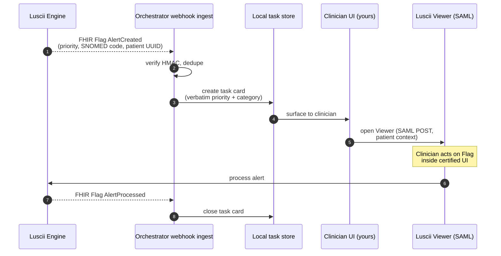

### MDR red lines around Flags

- **Never** hide / delay / re-prioritize a Flag before clinician sees it.
- **Never** auto-resolve a Flag in your wrapper — only the Luscii Viewer flow legitimately closes one (and emits `AlertProcessed`).
- **Never** re-derive Flags from raw Observations on your side. That makes the orchestrator a Class IIa device.
- Routing Flags to "the right clinician" is fine — that is workflow, not clinical decision-making.
- Aggregating Flag counts in dashboards is fine — informational.

### Practical orchestrator todo-list shape

For each local user, store Flag cards keyed by:

```
(localUserId, lusciiPatientUuid, flagId, priority, category, snomedCode, createdAt, lastEvent)
```

Update on each webhook event. Render verbatim to clinician. Never compute your own urgency from raw observations.

---

## 14. Clinician UI on top of the orchestrator — what's safe to build

Standard pattern. Doable. Boundary matters.

### Two architectures

**A) Thin orchestrator UI + Luscii Viewer for clinical action** — recommended

```
Your UI:  ticket queue · assignment · cross-patient context · SLA · notes
                ↓ click ticket
Luscii Viewer (SAML POST embed): clinician actually processes the Flag
                ↓ Flag closed in certified UI
Webhook AlertProcessed → your UI closes ticket card
```

Low MDR risk. You own workflow. Luscii owns the clinical action surface.

**B) Fully custom clinician UI, no Viewer** — blocked

1. **No public API to close a Flag.** `AlertProcessed` only fires when someone closes the Flag in Luscii (Viewer or web app). No `PATCH /v1/flags/{id}/process` documented. Tickets you cannot close.
2. **Replacing the certified clinician interface** likely turns the orchestrator into the Class IIa device → MDR + ISO 13485 + notified body.

### Allowed in your clinician UI (no MDR escalation)

| Feature                                                       | OK? | Why                                       |
| ------------------------------------------------------------- | --- | ----------------------------------------- |
| Ticket queue across all patients / pathways                   | ✅  | Workflow                                  |
| Filter / sort / search tickets                                | ✅  | Workflow                                  |
| Assignment to specific clinician                              | ✅  | Workflow                                  |
| Round-robin / on-call routing                                 | ✅  | Workflow                                  |
| SLA timers, "responded within X min"                          | ✅  | Workflow                                  |
| Aggregate one patient's tickets across multi-Luscii-accounts  | ✅  | Identity glue, workflow                   |
| Internal notes / tags on tickets in your DB                   | ✅  | Annotation layer                          |
| Show priority + category + SNOMED type **verbatim**           | ✅  | Display of certified data                 |
| Show triggering Observation values **verbatim**               | ✅  | Display, no interpretation                |
| Click-through to Luscii Viewer for the actual action          | ✅  | Hand-off to certified surface             |
| Mirror measurement history from webhooks (display only)       | ✅  | Display, no interpretation                |

### Forbidden in your clinician UI

| Feature                                                       | Why no                                       |
| ------------------------------------------------------------- | -------------------------------------------- |
| Auto-close Flags based on rules                               | No API + MDR                                 |
| Re-prioritize Flags ("red is actually amber")                 | Significant modification of certified device |
| Hide Flags below a threshold                                  | Same                                         |
| Add your own clinical scoring (NEWS, MEWS, deterioration)     | Class IIa territory                          |
| Decide a measurement is "fine" without a Luscii Flag          | Re-deriving alerts                           |
| Trigger clinical action (meds, intervention) from your UI     | Clinical decision support → Class IIa        |

### Cross-pathway value-add (the reason to build this at all)

One human = multiple Luscii accounts (one per pathway block). Luscii Viewer is strictly one-account-at-a-time. A clinician opening "Patient X" in your UI gets what Luscii cannot give:

- Unified profile (your local user identity)
- Active blocks list (per Luscii account)
- Combined ticket queue across all of that patient's Luscii accounts
- Per-block: open Viewer (iframe / popout) via SAML for the certified action
- Internal collaboration layer (assignment, notes, tags) on top

### Wiring

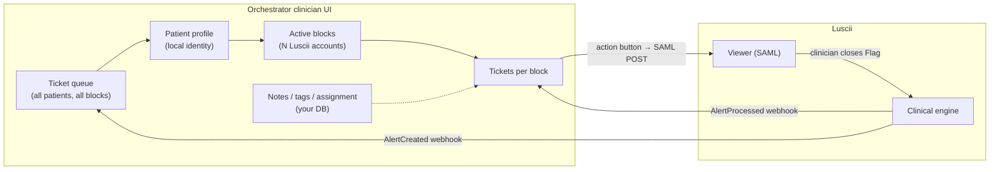

### MDR posture summary

Stick to **queue + route + display + click-through to Viewer** → workflow software, not a medical device. Same regulatory category as a hospital tasking layer.

Still need: GDPR Art. 9, DPIA, processor agreement with Luscii, NEN 7510 / ISO 27001, region-correct hosting.

The moment a "this Flag isn't urgent because the trend looks fine" rule lands in your code, you crossed into MDR Class IIa.

### Build order recommendation

1. Webhook ingest (Patient + Observation + Flag) with HMAC + dedupe
2. Local mapping table: `localUserId ↔ lusciiUuid ↔ programId ↔ blockId`
3. Ticket queue UI fed by Flag webhooks (verbatim priority + category + SNOMED)
4. Patient profile aggregating accounts
5. SAML POST hand-off into Viewer per active account
6. AlertProcessed webhook → close ticket card
7. Notes / assignment / SLA layer (orchestrator DB only)
8. Cross-pathway dashboards (counts, response times — informational only)

---

## 15. Create flow — user onboarding through orchestrator path builder

End-to-end: admin designs wrapper-path in path builder → user created in orchestrator → first Luscii block fires → patient enrolled in Luscii engine.

### 15.1 Path builder — admin composes wrapper-path (one-time setup)

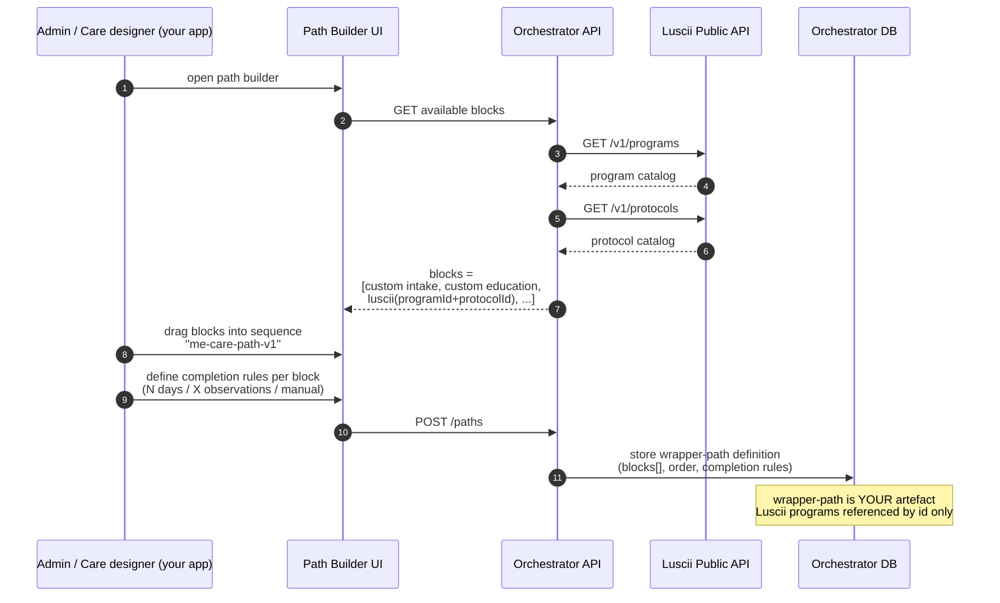

### 15.2 User create + start first block

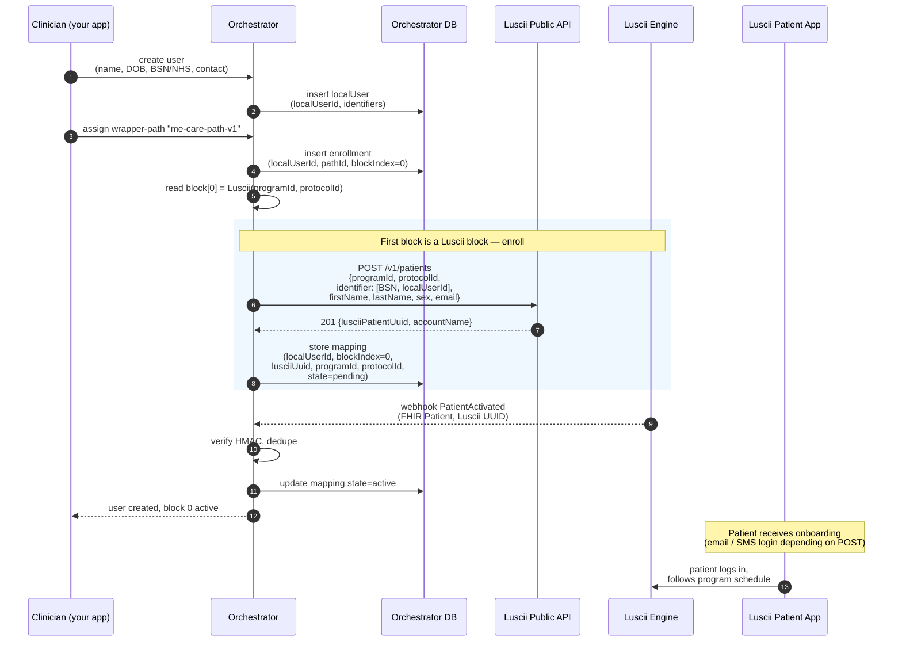

### 15.3 Custom (non-Luscii) block — orchestrator-only

If `block[i].type == custom`, orchestrator stays internal — no Luscii call. Used for intake forms, education content, manual clinician steps.

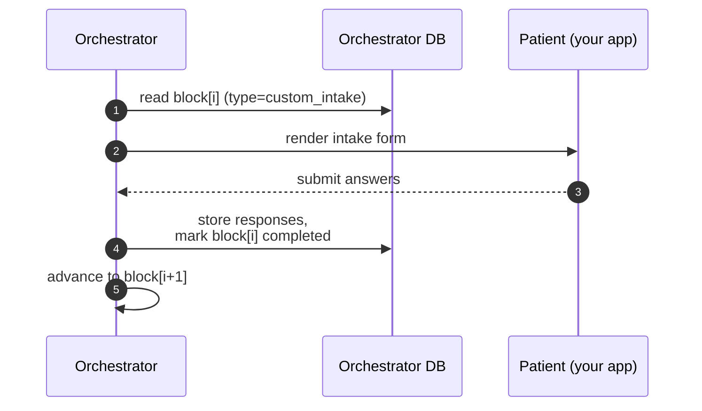

### 15.4 Block transition — from a Luscii block to the next

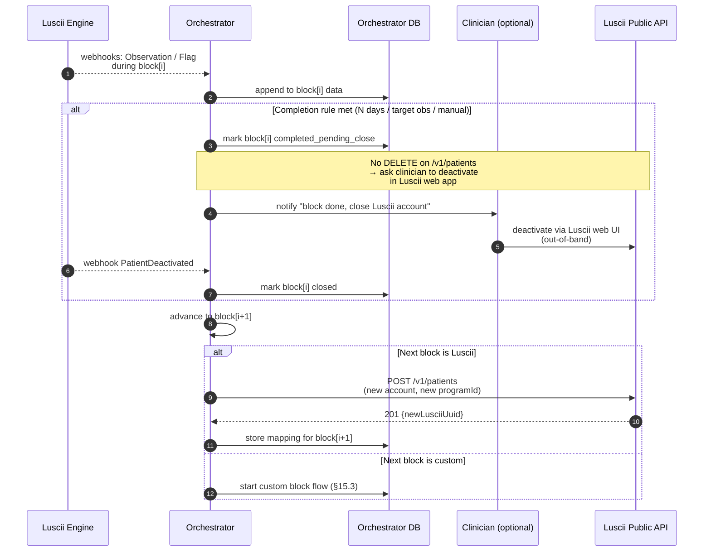

### 15.5 Data model for the create flow (orchestrator DB)

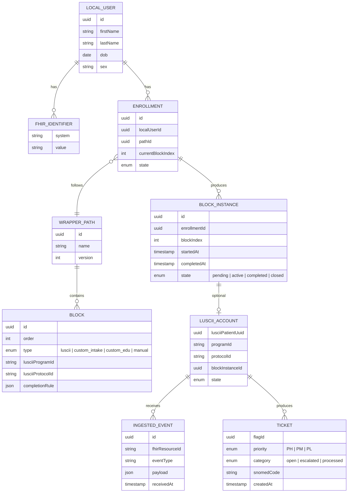

### 15.6 Decisions baked into the diagrams

- `localUserId` is passed as a FHIR identifier on every `POST /v1/patients` so webhooks can be joined back even before the response is stored.
- One `BLOCK_INSTANCE` per block per enrollment. One `LUSCII_ACCOUNT` per Luscii block instance.
- Block completion is **orchestrator-determined** (no Luscii signal). Closing the Luscii account is **clinician-driven** (no DELETE API).
- Custom blocks live entirely in your stack — they never touch Luscii.
- Patient app supports multi-account switching, so sequential Luscii blocks present cleanly to the patient (provided you only have one active at a time).

---

## 16. Open questions to verify with Luscii

- Exact OpenAPI spec for `vitalsapi.luscii.com/public-api/documentation` (live spec — fetch authenticated to inspect schemas).
- Whether `programs` / `protocols` endpoints are stable across program version bumps (do IDs change when a Medical Developer publishes a new revision?).
- Whether `programId` / `protocolId` can be changed on an existing patient account or strictly requires a new account.
- Webhook event filtering granularity (per-program subscriptions?).
- SLA + regional clusters relevant to deployment (EU vs UK vs EU-Acceptance).
- Confirmation of current IFU version + which MDR annex Luscii is certified under post-2024.
