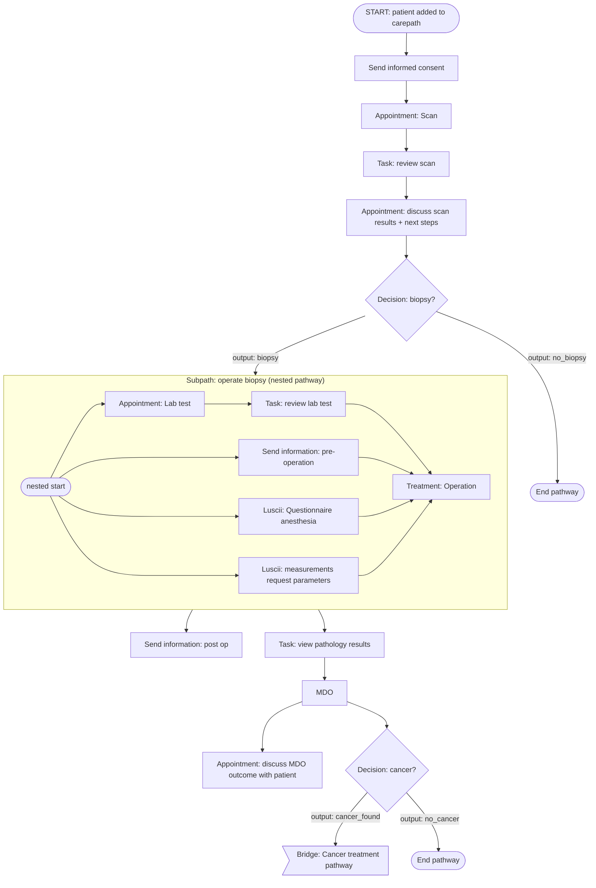

# Example flow — Urology diagnose + treatment pathway

Reference pathway authored by the design team to validate the redesigned block / pathway / edge model. This is the **goal flow** the model must be able to express, persist, render in the builder, and execute in the runtime.

Source: hand-drawn whiteboard sketch (screenshot in PR description). Reproduced below in Mermaid.

## Mermaid

## Block catalog used

| Block kind | Instances in this flow | Notes |
|---|---|---|
| `start` | 1 | Entry block, fires on enrollment |
| `send-informed-consent` | 1 | Two-actor lifecycle (caregiver action + patient completion) |
| `appointment` | 4 | Scan, discuss-scan, lab-test, post-MDO |
| `task` | 3 | review-scan, review-lab-test, view-pathology |
| `decision` | 2 | First (biopsy y/n), second (cancer y/n) |
| `subpath` | 1 | Operate biopsy — nested pathway-version reference |
| `treatment` | 1 | Operation |
| `mdo` | 1 | Multi-disciplinair overleg; N-of-M attendees contribute |
| `bridge` | 1 | Cancer treatment — cross-pathway handoff |
| `end-pathway` | 2 | One per decision negative branch |
| `luscii-program` | 2 | Anesthesia questionnaire + measurements |
| `notification` | 2 | Pre-op info + post-op info. **New kind — not in initial catalog.** Algemeen: email / SMS / in-app / push met inhoud. |

## Predicates used (closed catalog needed to express this flow)

| Predicate | Example use | Args |
|---|---|---|
| `if_done(node)` | "scan is made" | `node` |
| `result_field_equals(node, field, value)` | "patient has consented" → `Consent.given == true` | `node`, `field`, `value` |
| `decision_output(node, output_key)` | XOR routing on Decision blocks | `node`, `output_key` |
| `if_not_done_within(node, days)` | SLA / timeout (not visible in this flow, parked for now) | `node`, `days` |
| `aggregator_all_of` | AND fan-in at `Treatment: Operation` (4 branches) | composes input_logic entries |
| `aggregator_n_of_m` | MDO completion ("everyone has contributed") | inside MDO block, not generic |
| `event(node, event_type)` | In-execution escalation from Luscii measurements ("out of bounds") | `node`, `event_type` — **open design Q** |

## Timing rules visible

| Rule | Example | Proposed shape |
|---|---|---|
| `fixed_duration` | Static block duration | `TimingPolicy.FixedDuration(days=N)` |
| `wait_after(node, offset)` | Standard sequential wait | `TimingPolicy.WaitAfter(node, offset)` |
| **`wait_before(downstream_node, offset)`** | "Send pre-op info 5 days before Operation" | `TimingPolicy.WaitBefore(node, offset)` — **new primitive needed** |
| `at_enrollment_picked_date` | Operation date supplied at enrollment | Deferred field + TimingPolicy reads it |
| Per-instance schedule reference | "Send post-op info N days after Operation completes" | `WaitAfter(node="operation", offset="3 days")` reads `BlockExecution.completed_at` |

## Result shapes per block (typed per kind)

| Block | Result fields |
|---|---|
| `Start` | none |
| `Consent` | `given: bool`, `signed_at: datetime`, `method: "click" \| "biometric" \| "offline"` |
| `Appointment` | `scheduled_at: datetime` (deferred), `confirmed_by_patient: bool`, `attended: bool`, `outcome_notes: str?` |
| `Task` | `data_fields: dict[str, Any]` (form schema declared on instance) |
| `Decision` | `chosen_output: str` (one of declared output keys), `notes: str?` |
| `Subpath` | `nested_status: "running" \| "complete"` (spawned_enrollment_id on execution row) |
| `Treatment` | `treatment_notes: str?` |
| `MDO` | `decision: str`, `notes: str?` (attendees on execution row; contribution tracking inside block) |
| `Bridge` | `handed_off_at: datetime` (target_enrollment_id on execution row) |
| `LusciiProgram` | `program_status: "started" \| "completed" \| "abandoned"`, `last_event_at: datetime` |
| `Notification` | `delivered_at: datetime`, `opened_by_patient: bool?`, `opened_at: datetime?` |
| `EndPathway` | none |

## Deferred fields visible

| Block instance | Field | When supplied |
|---|---|---|
| Every `Appointment` | `scheduled_at` | At enrollment OR by caregiver during runtime |
| `Operation` | `scheduled_at` | Caregiver picks during runtime (drives all `wait_before` rules) |
| `Send information: pre-op` | `offset_days_before_operation` | Template default (5d) but builder can flip to deferred |
| `Send information: post-op` | `offset_days_after_operation` | Template default but builder can flip |
| `Luscii anesthesia` | `days_in_advance_of_operation` | Template default (4d) but builder can flip |

## Two-actor blocks visible

| Block | Caregiver does | Patient does |
|---|---|---|
| `Send informed consent` | Sends invite, presents form | Signs consent |
| `Appointment` | Schedules, confirms | Attends |
| `Luscii questionnaire` | (none — auto via Luscii) | Fills in |
| `Luscii measurements` | Reviews escalations | Submits measurements |

**Open design Q:** model as single block with multi-actor lifecycle, or split into chained blocks? See `design.md` D11 (to be added).

## In-execution events visible

| Block | Event during execution | Effect |
|---|---|---|
| `Luscii measurements` | Measurement out of bounds | Trigger escalation block (separate, not yet drawn) |

**Open design Q:** typed in-execution events on the block class, OR sub-blocks inside the block, OR an escalation predicate that watches Luscii result mid-flight. See `design.md` D12 (to be added).

## Open items from this walk-through

1. **NEW kind**: `Notification` → add to catalog + class hierarchy.
2. **NEW timing primitive**: `TimingPolicy.WaitBefore(downstream_node, offset)` → bidirectional schedule references.
3. **NEW concept**: in-execution events distinct from state-transition events.
4. **MDO completion logic**: per-class `complete_if` method, not a generic predicate (confirms class-hierarchy direction).
5. **Two-actor blocks**: lifecycle vs chained-blocks design call.
6. **Subpath**: confirmed as nested pathway-version reference; the outer pathway sees Subpath as one opaque block with one output; the inner pathway has its own internal structure.
7. **Deferred fields cascade**: `Operation.scheduled_at` (deferred) drives N other blocks' computed scheduling via `WaitBefore` / `WaitAfter`. The runtime engine must reschedule downstream when the anchor is updated.
